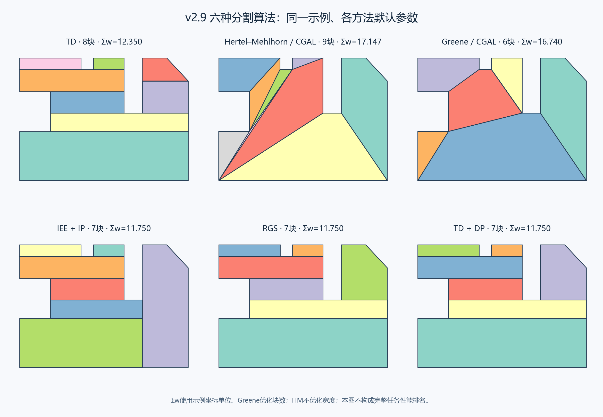

# v2.9 六种多边形分割算法实现报告

交付日期：2026-10-21。基线为本轮开始时的v2.8源码，范围为TD、Hertel–Mehlhorn、Greene、IEE＋IP、RGS和TD＋DP。此次不增加风覆盖时间模型，继续输出保持原区域边界、无面积重叠的凸分区，并接入现有扫描与路径规划模块。

应用版本、工程与实验写入版本、Windows资源、构建配置和源码根目录同步为v2.9；独立历史平台共享配置同步。**本次没有打包应用exe；HM/Greene使用的原生计算DLL已编译并随源码提供。** 启动入口为`start.bat`或`python main.py`。

## 1. 实现到了哪里

| 方法 | 本轮已完成 | 实现定位 |
| --- | --- | --- |
| TD | 从顶点向上下发出射线，到首次区域边界停止；对线网统一求交、节点化、构造梯形单元；多方向按最小宽度和选优 | 几何构造已改为局部射线；保留工程几何实现 |
| Hertel–Mehlhorn | 直接调用CGAL 6.0.1的`approx_convex_partition_2`；使用参考约束三角剖分、内部边遍历和删边实现 | 参考实现直接接入，已去掉耳切＋最长共边优先规则 |
| Greene | 直接调用CGAL 6.0.1的`optimal_convex_partition_2`，执行原始最优凸分解DP；不增加Steiner顶点 | 真正的参考DP，已去掉有限状态对角线递归及HM回退 |
| IEE＋IP | 凹点邻边向内延伸至首次边界；按Nielsen算法1的平衡组合生成凸候选；按式1～3进行0/1集合划分，目标为宽度和 | 论文的几何切分、候选近似和IP目标均已落实 |
| RGS | 对每个凹顶点候选切分，递归求解其子区域后再比较代价；增加记忆化；多旋转方向搜索 | 对齐递归比较结构，采用保持原边界的最小宽度代理版本 |
| TD＋DP | 使用新TD；建立单元邻接；枚举邻接集合的凸合并候选；自底向上集合状态DP；多方向选优 | 已去掉连续质心排序限制，采用原边界内的宽度代理重组 |

HM和Greene使用C++参考算法，Python仅负责调用、输入预处理及最终几何校验。固定同一CGAL版本、内核和预处理输入时，剖分和遍历规则由参考函数本身执行，不再在Python中另定合并顺序。实际总耗时还包含Python/原生数据转换和Shapely验证开销，因此不承诺与其他电脑、其他内核或其他构建的绝对耗时相同。

## 2. 各方法仍有哪些差异

**TD**

- 使用局部首次边界射线，避免旧全域条带在远处其他分支上增加分界。
- 仍由Shapely/GEOS完成射线求交、线网节点化和多边形构造；没有移植Seidel随机增量或专门事件数据结构，不能宣称已达到论文引用实现的`O(n log n)`复杂度。
- 默认尝试6个方向，以宽度和选择；不是连续角度全局优化，也不是有风覆盖时间选优。
- 同一横坐标多顶点、射线交会等退化情况由统一线网构造处理，具体数值规则不保证与论文未公开的实现逐位相同。

**Hertel–Mehlhorn**

- 用户要求的剖分方式、合并遍历及核心实现效率，已通过直接接入参考函数完成。
- 固定后端为CGAL 6.0.1，内核为`Exact_predicates_inexact_constructions_kernel`，精确谓词回退采用Boost.Multiprecision；没有修改参考三角剖分和删边代码。
- 项目仍先统一环方向、清理近共线点并平移缩放，再校验输出。参考一致性针对同样预处理后的输入；不是任意原始文件字节与任意CGAL配置的结果完全相同。
- HM不保证最少块，也不优化宽度和。本轮没有再加“宽度更好才采用参考结果”的替换规则。

**Greene**

- 已使用参考的多项式DP，目标仍是无Steiner顶点条件下的最少凸块。
- 完成计算的结果记录`minimum_count_proven=true`；不再因旧3000状态预算返回近似分区。
- 证明针对当前预处理的无孔简单多边形。浮点输入、近共线清理和几何容差仍属于项目接口条件。
- 仍未增加孔洞支持；原始算法的最坏时间`O(n^4)`、空间`O(n^3)`仍需考虑，不能把小算例的毫秒结果推广到任意规模。
- 独立计算进程仍支持停止和任务超时。进入原生函数后没有内部迭代进度回调，父进程可终止整个任务。

**IEE＋IP**

- 原来的整条支撑线和最少块目标已替换；基本单元在原始区域内由首次边界射线共同构造。
- 使用论文§3.3、算法1的平衡凸组合近似：生成大小为`i`的候选时，组合大小为`floor(i/2)`和`ceil(i/2)`的候选。**该近似是论文自身的做法，不是全体凸组合枚举。**
- 在此基础上仍保留用户可调的合并规模、候选数量、MILP时间上限。这些额外工程限制及求解状态会写入结果。
- 当前无孔输入不支持论文涉及的内部障碍。几何运算采用GEOS，整数规划采用SciPy/HiGHS，不是逐行移植作者R程序及其求解器。
- `optimal_within_candidates=true`表示求解器已证明给定候选内最优，不能解释为全部可能切分中的全局最优。

**RGS**

- 旧版“按即时凸包宽度选定一刀，再只递归这一支”已替换。现在各凹点候选都会先递归，再比较最终凸片的宽度和。
- 未启用原文“直接覆盖当前区域凸包”的候选。当前项目的凸分区、扫描和评价要求保留原始ROI；没有放宽这项条件。
- 最小宽度和是本轮选择的几何代理，未声称逐式复现论文的有风时间评价或其他成本公式。
- 没有增加风、固定翼转弯动力学、禁飞区代价或外扩飞行区域模型。
- 默认6方向搜索，不是连续角度最优；状态预算用尽会明确报错，不返回一个被冒充为完整搜索结果的其他算法分区。

**TD＋DP**

- 合并对象是实际相邻单元集合，允许跨过旧质心排序中的位置；不再局限于一个连续区间。
- 先枚举邻接集合，再使用覆盖集合的自底向上DP选择分区。状态为已经覆盖的基本单元集合，按覆盖单元数量递增处理。当前最低未覆盖单元必须被下一候选覆盖，以消除分区排列的重复。
- 当前候选枚举允许经过非凸中间集合，只在其凸包超出ROI时剪枝；因此搜索组织与原文“当前合并/新起一组”的网络遍历和剪枝顺序不同，不能声称逐步相同。
- 使用宽度和代替有风覆盖时间，宽度并列时选择较少块数。没有加入ROI与凸包之间的可选外部单元。
- 完整枚举且DP完成时，`optimal_for_fixed_td=true`表示在该固定TD及本轮宽度目标下最优，不代表所有切分、所有方向或完整航线全局最优。
- 若子集枚举预算触顶，仍可在已生成凸候选中求解，结果记录候选受限；若DP状态预算触顶则明确报错。

## 3. 实际结果与取舍

使用原说明文档的同一17顶点示例，各版本采用各自默认参数。宽度为示例坐标单位；这是分割对照，不是完整任务性能排名。

| 方法 | v2.8块数 | v2.9块数 | v2.8宽度和 | v2.9宽度和 |
| --- | ---: | ---: | ---: | ---: |
| TD | 8 | 8 | 13.000000 | 12.350000 |
| HM | 9 | 9 | 16.343445 | 17.147380 |
| Greene | 6 | 6 | 16.740002 | 16.740002 |
| IEE＋IP | 7 | 7 | 13.000000 | 11.750000 |
| RGS | 9 | 7 | 12.350000 | 11.750000 |
| TD＋DP | 7 | 7 | 13.000000 | 11.750000 |

HM在该例宽度和增加，这是参考剖分与删边顺序带来的真实结果；实现一致性已经达成，但不保证宽度改善。Greene两版同为6块，新版完成最少块证明，旧版则触及3000状态预算、未证明最优。

本机同一进程的一次完整分割调用中，旧Greene约19.28秒，参考DP新版约0.0027秒。这个差异只描述此算例和这次测量。新版TD默认从单方向变为6方向，RGS搜索了更多递归候选，TD-DP扩大了组合范围，因此这些方法在该例耗时有所增加；未据此声称各方法均变快。

IEE在该例生成22个基本单元和112个论文近似候选，未触及额外候选预算，MILP完成最优证明；该结果仍是候选内最优。RGS选90°，计算202个记忆化状态。TD-DP同样选90°，最终为7块、宽度和11.75。

## 4. 参数与旧工程兼容

| 方法 | 新建方案默认参数 | 说明 |
| --- | --- | --- |
| TD | `td_angle_deg=0`，`td_rotations=6` | 以起始角为基准，在180°内均匀采样；方向数设1即可固定角度 |
| HM | 无 | 固定调用参考函数 |
| Greene | 无 | 旧`greene_state_budget`加载组合时自动移除，不再显示失效参数 |
| IEE＋IP | `iee_max_merge_cells=0`，`iee_max_candidates=10000`，`iee_time_limit_s=10` | 合并规模0表示不额外限制；论文自身平衡组合近似始终存在 |
| RGS | `rgs_rotations=6`，`rgs_max_states=50000` | 达到状态上限明确报错 |
| TD＋DP | `td_angle_deg=0`，`td_rotations=6`，`tddp_max_subsets=50000`，`tddp_max_states=100000` | 候选子集限制和DP状态限制分别记录/处理 |

原有分割ID及组合方式保留，六种方法仍可接入原有7种规划器。旧组合显式保存的IEE上限等参数继续生效；例如旧值8不会自动变成新默认0。已有历史实验仍按其原始快照显示，本轮没有重算或改写旧实验。

新结果记录`implementation_version=2.9`、`implementation_scope`、几何约束、宽度和；HM/Greene另记CGAL版本及参考函数；其他方法按需记录候选限制、角度、搜索状态和最优性范围。新的实现边界也已同步到界面方法名称与提示。

## 5. 已执行的验证

- 20个输入乘6种方法，共120次分割及扫描兼容检查通过。其中包含现有数据集库的7个实际地块、文案示例、分支形、共线闭环、细尖角、UTM大坐标变换及8个随机凹形输入。
- 每次检查有效性、正面积、凸性、并集与原区域的面积差、内部面积重叠，并让实际扫描器接受各子区、生成4个覆盖变体。几何检查采用与生产程序一致的容差。
- 在小问题上，用独立的全子集枚举＋MILP核验集合DP的宽度目标。另用“5块风车式矩形分区”验证非凸中间组合能够最终合成一个凸块，未被错误剪掉。
- 用小型多边形的穷举合法对角线搜索，核对Greene参考DP的最少块数。
- 六种方法均完成一次“分割→扫描→ACO连接→闭环航点”的进程内检查，并在实际spawn工作进程中各完成一次。该检查使用3轮ACO，仅验证接入，不作路线性能对照。
- 已检查旧Greene参数迁移、IEE/TD-DP候选受限标志、RGS/TD-DP状态超限报错、六种方法取消操作、方法列表及参数规格。
- 原生库为Windows x64，运行依赖为系统运行库；无需pip安装CGAL。应用exe未重新构建，因此本轮没有exe打包后运行验证。

这批检查验证了本轮分割改动及接入条件，不是论文实验数据集或实飞性能复现。宽度更小、块数更少与完整任务总航程更短之间仍需用实际任务验证。

## 6. 代码与参考资料

主要实现：`algorithms/decomposition_methods.py`；原生接口：`algorithms/cgal_partition.py`及`algorithms/native/partition.cpp`；旧参数迁移：`core/combinations.py`。

原生源码、固定版本、编译选项、可重建依赖下载地址及SHA-256见[原生库说明](algorithms/native/README.md)。随附CGAL及Boost许可证。当前预编译计算库面向Windows x64，其他平台需按说明重建并调整库加载文件名。

论文与参考实现：

1. [CGAL 6.0.1 Polygon Partitioning手册](https://doc.cgal.org/6.0.1/Partition_2/index.html)：HM和Greene参考实现及适用条件。
2. [CGAL v6.0.1参考源码](https://github.com/CGAL/cgal/tree/v6.0.1/Partition_2/include/CGAL/Partition_2)：`partition_approx_convex_2.h`和`partition_optimal_convex_2.h`。
3. [Nielsen等，2019，IEE＋IP](https://pmc.ncbi.nlm.nih.gov/articles/PMC6806237/)：§3.1～3.3、式1～3、算法1；[作者R代码](https://github.com/LasseDamtoft/InteriorEdgeExtension)。
4. [Coombes等，2020，RGS](https://onlinelibrary.wiley.com/doi/full/10.1002/rob.21928)：原PDF第7～10页，§3、算法1/2。
5. [Coombes等，2018，TD＋DP](https://pmc.ncbi.nlm.nih.gov/articles/PMC6068989/)：原PDF第11～18页，§3/4、式20/21、算法1。

原先的说明动画及v2.8差异评估保留为历史材料，不能用于说明v2.9的内部步骤。本报告记录本次交付的实际状态。BCD、ACD和文献②的单轴可扫描性主方法不在本轮新增范围内。
